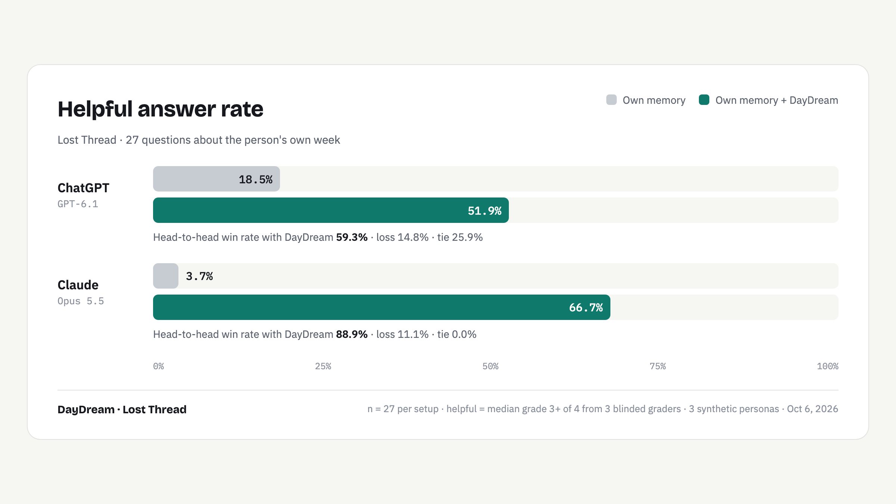

# Lost Thread: An Open Benchmark for AI Memory

AI assistants know a lot about the world and very little about you. Ask ChatGPT or Claude what your team decided on
Tuesday, which article you kept reopening, or the reservation number you looked at on Friday, and they either say they
don't know or guess. Their built-in memory holds a handful of saved facts, not what you actually did.

Lost Thread measures that gap: 27 questions about three synthetic work weeks (a developer, a student and a founder),
asked the way people really ask. Each model answers with its own memory, then with a record of the week from
[DayDream](https://getdaydream.app). Blinded judges score whether each answer was right and whether it helped.

## Results (v1, October 6, 2026)

| n = 27 | ChatGPT | ChatGPT + DayDream | Claude | Claude + DayDream |
|---|---|---|---|---|
| Helpful answer rate | 18.5% | **51.9%** | 3.7% | **66.7%** |
| Accuracy | 27.8% | **61.1%** | 13.0% | **74.1%** |
| Head-to-head win rate | 14.8% | **59.3%** | 11.1% | **88.9%** |
| No made-up facts | **96.3%** | 92.6% | **100.0%** | 92.6% |
| No overclaims | **100.0%** | 92.6% | **100.0%** | 96.3% |

ChatGPT is `gpt-6.1-sol` via Codex CLI; Claude is `claude-opus-5-5` via Claude Code. Both get the same system prompt
and their own saved memories. Judges are 3 blinded Claude Sonnet 5.5 per answer (median); head-to-heads are judged
twice with sides swapped. Answer length didn't predict score (r = −0.08). ChatGPT chose to use DayDream on 16 of 27
questions, Claude on 26.

## Use it

- **Re-grade with your own judge.** Our judges are Claude models, and one contestant is Claude. `regrade.py` runs the
  same instructions on any OpenAI-compatible API. If your judge disagrees, open an issue with the numbers.
- **Run your memory tool on it.** Any tool with an MCP server can replace DayDream: [docs/ADD-YOUR-TOOL.md](docs/ADD-YOUR-TOOL.md).
- **Check our numbers.** `python3 bench/lt_judge.py score grading/lost-thread-20261006` recomputes every result from
  the raw grades. Full rerun steps: [docs/REPRODUCE.md](docs/REPRODUCE.md).

Everything is here: the frozen questions and their hash, the three weeks, all 162 answers, every judge's output.

## Limits

Synthetic weeks, 27 questions per setup, and Claude judges. DayDream answers made up a detail slightly more often.
Details: [docs/LIMITS.md](docs/LIMITS.md).

MIT licensed, code and data.
